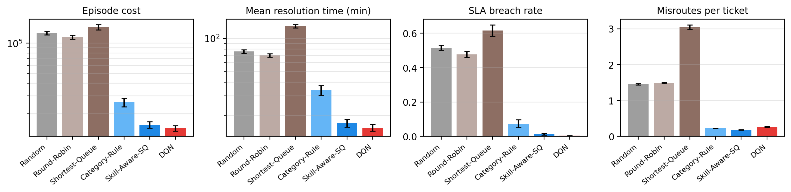
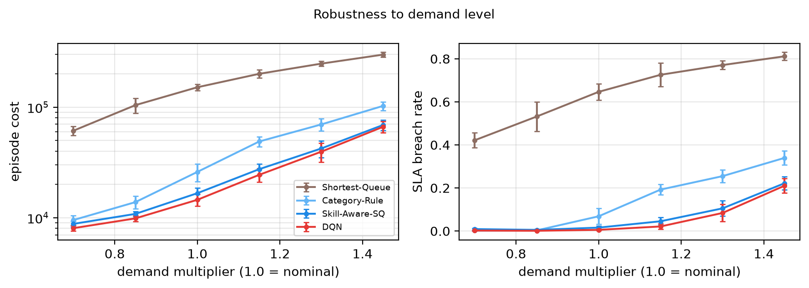
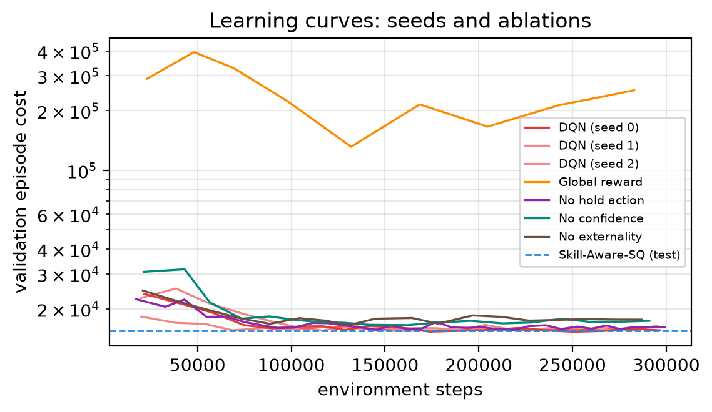
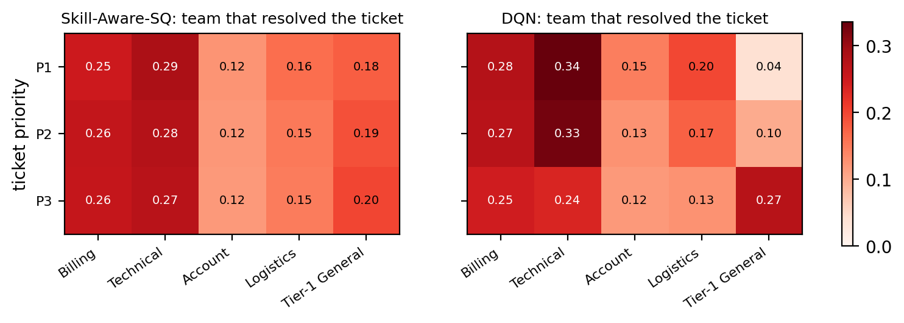

# RouteRL — Reinforcement-Learning Dispatcher for Customer-Support Tickets

> AI Assignment 2 (Real-Life Use Cases of RL) · Team: Siddharth Bhagat (B23MT1040), Kunal Jangid (B23MT1026) · Report: [`report/routeRL_report.pdf`](report/routeRL_report.pdf) (source: [`report/report.tex`](report/report.tex))

Support tickets that land with the wrong team bounce between queues ("ticket ping-pong"),
wait longer and breach their Service-Level Agreements (SLAs). **RouteRL** casts ticket
routing as a Markov Decision Process: for every incoming ticket a dispatcher observes the
team queues, agent availability, the ticket's priority, its SLA slack and a *noisy* category
prediction from an upstream text classifier, and either **routes** it to one of five teams
or **holds** it for a minute. Rewards penalise waiting time, misroutes and SLA breaches.
A Double/Dueling **DQN implemented from scratch in PyTorch** is benchmarked against
round-robin, shortest-queue and two stronger skill-aware heuristics.

## Results at a glance

30 held-out 8-hour shifts (≈594 tickets each), identical ticket streams for every policy,
mean ± 95 % CI:

| Policy         | Episode cost ↓   | Mean resolution (min) | SLA breach rate | P1 breach rate | Misroutes / ticket |
| -------------- | ---------------- | --------------------- | --------------- | -------------- | ------------------ |
| Random         | 126,621 ± 5,287  | 76.0                  | 51.6 %          | 21.8 %         | 1.45               |
| Round-Robin    | 115,133 ± 5,463  | 70.3                  | 47.7 %          | 20.1 %         | 1.49               |
| Shortest-Queue | 144,620 ± 8,724  | 129.0                 | 61.6 %          | 30.6 %         | 3.05               |
| Category-Rule  | 25,961 ± 2,472   | 34.0                  | 7.4 %           | 1.3 %          | 0.22               |
| Skill-Aware-SQ | 15,525 ± 1,068   | 17.0                  | 1.3 %           | 4.1 %          | **0.18**           |
| **DQN (ours)** | **14,089 ± 812** | **15.2**              | **0.3 %**       | 1.5 %          | 0.24               |

- **−88 % / −90 %** cost vs. the proposal's Round-Robin / Shortest-Queue baselines, **−46 %**
  vs. classifier-label routing, **−9.3 %** vs. the strongest heuristic (Skill-Aware-SQ), which
  the DQN beats on **29/30** paired shifts (paired saving 1,436 ± 349, t = 8.1).
- SLA breaches drop **4×** (1.3 % → 0.3 %), P1 breaches **2.7×** (4.1 % → 1.5 %).
- Three training seeds: cost 14,131 ± 76 (std) — training is stable.
- Robust to demand: the DQN is the cheapest policy at **every** demand level from 0.7× to 1.45×
  (−8.5 % … −3.7 % vs. Skill-Aware-SQ); at 1.45× all three seeds beat the heuristic.
- Learned behaviour: the agent keeps urgent work on fast specialists and pushes low-priority
  overflow to the slow generalist (P1 → generalist 6 % vs. 18 % for the heuristic; P3 → 23 % vs. 20 %).

|                                                             |                                                                     |
| ----------------------------------------------------------- | ------------------------------------------------------------------- |
|  |                        |
|      |  |

**Ablations** (same budget, 30 test shifts; `results/ablation_summary.csv`,
`results/ablation_summary_stress.csv`):

| Variant        | Cost (1.0×) | Cost (1.45×) | Note                                                                    |
| -------------- | ----------- | ------------ | ----------------------------------------------------------------------- |
| DQN (full)     | 14,089      | 61,377       | per-ticket credit assignment + semi-MDP discounting + hold cap          |
| Global reward  | 126,158     | 278,315      | learns from the system-wide cost stream → never learns (56 % breaches)  |
| No confidence  | 14,571      | 64,013       | sees only the classifier's top-1 label → +3.4 % cost                    |
| No hold action | 13,732      | 58,931       | with the fixes below the hold action is not needed                      |
| No externality | 14,519      | 67,077       | +3.1 % at nominal, +9.3 % under overload (25 % vs 19 % breaches)        |
| Skill-Aware-SQ | 15,525      | 64,219       | strongest heuristic, for reference                                      |

## 1. The MDP

**Simulator** (`routerl/env.py`, Gymnasium API, 1 step = 1 routing decision, clock = minutes)

| Element            | Model                                                                                                                                                                    |
| ------------------ | ------------------------------------------------------------------------------------------------------------------------------------------------------------------------ |
| Ticket categories  | billing, technical, account, logistics (mix 30/35/15/20 %)                                                                                                               |
| Priorities / SLA   | P1 / P2 / P3 (15/35/50 %), resolve within 30 / 60 / 120 min                                                                                                              |
| Teams (agents)     | Billing (3), Technical (4), Account (2), Logistics (2), Tier-1 General (4)                                                                                               |
| Handling time      | specialists 6–10 min on their own category; generalist 10–25 min on any category; Gamma-distributed work per ticket                                                      |
| Misrouting         | a team without the skill spends 3 min triaging, then bounces the ticket back, correctly re-tagged                                                                        |
| Classifier         | softmax(clarity · one-hot(true) + Gaussian noise); top-1 accuracy ≈ 75 %                                                                                                 |
| Demand             | 8-hour shift, Poisson arrivals with a mid-shift peak (+35 %), 50 % chance of a 45-min incident surge (×2 in one category); demand randomised ×[0.7, 1.5] during training |
| Agent availability | idle agents go on breaks (1 %/min, mean 15 min)                                                                                                                          |

**State** $s \in \mathbb{R}^{39}$: ticket features (classifier probabilities ×4, priority one-hot ×3,
normalised SLA slack, re-tagged flag, number of holds, number of misroutes), per-team features
×5 teams (queue length, tickets ahead of this one by priority, idle-agent share, on-shift share,
minutes until the next agent frees up) and global features (shift progress, dispatcher backlog,
recent arrival rate).

**Actions** $a \in \lbrace 0,\dots,5 \rbrace$: route to Billing / Technical / Account / Logistics / Tier-1, or *hold*
(re-decide next minute). A ticket may be held at most `max_holds = 5` times; `env.action_mask()`
reports the legal actions.

**Reward** $r = -\lambda \Delta C$ with the operating cost

$$C = \sum_{i} \Big( w_{p_i} T_i + B_{p_i} \mathbf{1}[T_i > \mathrm{SLA}_{p_i}] + M \cdot m_i \Big)$$

where $T_i$ is the ticket's time to resolution, $m_i$ its number of misroutes,
$w = (3, 2, 1)$ per minute, $B = (50, 25, 10)$, $M = 5$ and $\lambda = 0.05$ (`env.reward_scale`).

**Learning** (`routerl/dqn.py`, `train.py`): Double DQN + dueling head, Huber loss, soft target
updates, ε-greedy exploration, and checkpoint selection on the geometric-mean validation cost at
demand 1.0× / 1.3× / 1.45× (`dqn.val_loads`), plus three design choices that turned out to be
essential:

1. **Semi-MDP discounting** — decisions are irregularly spaced in time, so targets use
   $\gamma^{\Delta t}$ per elapsed minute rather than per decision, and every cost term inside a
   transition is discounted to the decision time. Otherwise the same wait looks cheaper when it is
   split up by holds, which made an earlier version hold tickets 25–35 times under overload.
2. **Per-ticket credit assignment** — every cost term belongs to exactly one ticket, so the
   total cost decomposes exactly into per-ticket costs. Each transition follows one ticket from a
   decision to its next decision (after a hold or bounce) or to its resolution, and one shared
   Q-network is trained on all of them. A marginal-cost (Pigouvian) term charges a ticket for
   the delay its service imposes on tickets already queued at the same team (training signal
   only; reported costs never include it). The `global` credit-assignment mode is kept as an
   ablation.
3. **Hold cap with action masking** — the illegal hold action is masked when acting and in the
   Double-DQN target's argmax (the next state's action mask is stored in the replay buffer).

## 2. Installation

Python ≥ 3.10 (tested on Python 3.13 / Windows 11 and Python 3.10 / Ubuntu 22.04). A CPU is enough; no GPU is needed.

```bash
git clone https://github.com/sidbhagat40/RouteRL.git && cd RouteRL
python -m venv .venv
# Windows: .venv\Scripts\activate      Linux/macOS: source .venv/bin/activate
pip install -r requirements.txt
```

Dependencies: `numpy`, `torch`, `gymnasium`, `pandas`, `matplotlib`, `pyyaml`, `pytest`.

## 3. Usage

```bash
# Unit tests (Gymnasium API check, cost accounting, determinism, n-step returns, ...)
python -m pytest -q

# Evaluate the trained agent in models/ against all baselines (~3 min);
# writes CSVs to results/ and figures to results/figures/
python evaluate.py --model models/dqn_routerl.pt --episodes 30

# Train a new agent (~15-20 min on a laptop CPU)
python train.py --config configs/default.yaml --seed 0

# Reproduce every model in the report (3 seeds + 4 ablations in parallel, ~20 min on 8 cores)
python run_experiments.py --parallel 7 --threads 2
python evaluate_ablations.py --episodes 30
```

All hyper-parameters live in [`configs/default.yaml`](configs/default.yaml); ablation configs
only list the keys they override.

## 4. Reproducibility

- Every episode is generated from one integer seed (`SeedSequence` → independent streams for
  ticket arrivals and agent breaks). All policies are evaluated on **identical ticket streams**
  (common random numbers), which makes paired comparisons possible.
- Seed ranges: training `seed·100000 + episode`, validation `1000–1004` (model selection),
  test `10000–10029` (headline table), load sweep `10500–10509`, backlog trace `10900+`.
- `models/dqn_routerl.pt` is the checkpoint with the best validation cost; it embeds the full
  environment and DQN configuration it was trained with. `models/seeds/` and
  `models/ablations/` hold the other report models; `results/` holds every CSV and figure.

## 5. Repository layout

```
routerl/
  config.py       EnvConfig / DQNConfig dataclasses + YAML loading
  env.py          helpdesk simulator (Gymnasium Env) with per-ticket transition tracking
  baselines.py    Random, Round-Robin, Shortest-Queue, Category-Rule, Skill-Aware-SQ
  dqn.py          Q-network, replay buffer, n-step accumulator, DQN agent
  evaluation.py   roll-outs on fixed seeds, metric aggregation with 95% CIs
  plotting.py     figures used in the README / report
train.py              training loop (validation-based checkpointing, CSV log)
evaluate.py           benchmark + load sweep + backlog trace + learning-curve figures
run_experiments.py    trains all report models (seeds + ablations)
evaluate_ablations.py seed-robustness and ablation tables/figures
configs/              default and ablation configurations
models/               trained checkpoints
results/              CSV results, training logs and figures
report/               LaTeX source of the 2-page report (compile on Overleaf)
tests/                pytest suite
```

## 6. Originality

All code in this repository (simulator, baselines, DQN, training and evaluation) was written
for this project; no RL library (e.g. Stable-Baselines) or external repository was used. Only
general-purpose libraries (PyTorch, NumPy, Gymnasium's `Env` interface) are imported.
